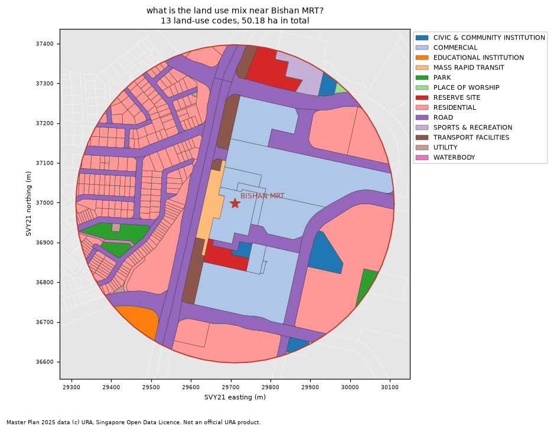

# sg-masterplan-assistant

**Personal project on open data; not a URA tool; Master Plan data © URA, Singapore Open Data Licence.**

A planner types a question in plain English about Master Plan 2025 land-use zoning. The
assistant turns it into a small, allow-listed, read-only query, runs it on a committed
extract of the data, and returns a map, a table, and the query it ran so the planner can
check it.

> README generated by `scripts/build_readme.py` from `results/*.json`; edit
> `docs/README.template.md`, not this file.

## Try it

```
python -m venv .venv
.venv/Scripts/pip install -r requirements.txt      # Linux/macOS: .venv/bin/pip
set PYTHONPATH=src                                  # Linux/macOS: export PYTHONPATH=src
python -m sgmp.cli "which residential parcels in Bishan have GPR above 3?" --out out
python -m sgmp.cli "how much land near Bishan MRT is zoned business?" --out out --llm   # optional, needs Ollama
python -m pytest -q
```

Each answer writes `out/query.txt` (the query, its SQL form, units, data vintage, warnings),
`out/table.csv` and `out/map.png`.

## Example answers (rule-based parser)

| Question | Answer | Output |
|---|---|---|
| which residential parcels in Bishan have GPR above 3? | 12 parcels listed, 22.56 ha in total | [query, table, map](docs/examples/1/query.txt) |
| how much land near Bishan MRT is zoned business? | 0 m2 (0.00 ha) across 0 parcels | [query, table, map](docs/examples/2/query.txt) |
| what is the land use mix near Bishan MRT? | 13 land-use codes, 50.18 ha in total; largest is RESIDENTIAL at 18.62 ha | [query, table, map](docs/examples/3/query.txt) |
| list white sites in Downtown Core | 66 parcels listed, 58.09 ha in total | [query, table, map](docs/examples/4/query.txt) |

The second answer is a true zero, not a failure: within the default 400 m of Bishan MRT the
2025 plan has no Business 1, Business 2 or Business Park parcels; the third question shows
what is there instead.



## How it works

1. **Parse.** A question becomes a JSON query in a fixed language (`src/sgmp/dsl.py`):
   operation (`list`, `count`, `total_area`, `breakdown`, `refuse`), a spatial scope (planning
   area, subzone, or a buffer around an MRT station), optional land-use codes, an optional GPR
   threshold, and optional sort/limit. Two parsers produce it:
   - a deterministic rule-based parser (`src/sgmp/parser_rules.py`), the baseline and the default;
   - an optional local LLM through Ollama (`src/sgmp/parser_llm.py`, model `qwen3.5:4b`), off by default.
2. **Validate.** Every query, from either parser, passes the same validator: unknown keys,
   unknown land-use codes, places outside the extract, radii outside 50 to 2000 m and
   missing spatial scope are rejected. Nothing else can reach the data, so there is no SQL
   string to inject into and no write path.
3. **Execute.** GeoPandas filters the in-memory extract (EPSG:3414, metres). Near-station
   queries keep parcels that touch the buffer and count only the part inside it.
4. **Show.** Map PNG, table CSV, and `query.txt` with the JSON query, an SQL rendering of it,
   units, data vintage and coverage warnings.

## Evaluation

Answer keys are computed by `eval/compute_expected.py`, which reads the GeoJSON with plain
`json` + `shapely` and does not import the assistant's code. A question scores as correct
only if executing the parsed query gives the key's answer: the same parcel IDs in the same
order for lists, the same count, or areas within a relative tolerance of 0.1%.

Two question sets:

- **Main set** (`eval/questions.jsonl`): 34 answerable
  questions and 14 that must be refused (out of scope,
  unsafe, places not in the extract, radius too large). I wrote these myself and committed
  them before the parser existed, but I then wrote the parser, so the baseline's score on
  this set is optimistic.
- **Held-out set** (`eval/heldout_questions.jsonl`): 20
  answerable + 6 refusal questions written by a
  separate model session that was told not to read the parser or the main set. The
  first-run column is the honest one: I fixed the parser after seeing those failures, so
  the after-fix column is no longer blind.

| Parser | Set | Execution accuracy | Correct | False refusals | Refusal rate | Median s / question |
|---|---|---|---|---|---|---|
| rules, first run | main | 100.0% | 34/34 | 0 | 100.0% (14/14) | 0.0 |
| rules, first run (blind) | held-out | 70.0% | 14/20 | 0 | 83.3% (5/6) | 0.0 |
| rules, after fixes | main | 100.0% | 34/34 | 0 | 100.0% (14/14) | 0.001 |
| rules, after fixes (not blind) | held-out | 100.0% | 20/20 | 0 | 100.0% (6/6) | 0.001 |
| llm:qwen3.5:4b, single run | main | 88.2% | 30/34 | 0 | 100.0% (14/14) | 7.007 |
| llm:qwen3.5:4b, single run | held-out | 70.0% | 14/20 | 3 | 100.0% (6/6) | 7.96 |

The LLM ran with sampling temperature set to zero on a laptop, once per set; its prompt and few-shot examples
were not tuned on either set. The LLM rows are not checked by CI.

The scorer is strict: list answers must match in order, and a query with an extra filter
the question did not ask for is wrong even if it happens to return the right number. Some
LLM failures below are of that kind (an unrequested subzone, sort or limit); others put
a subzone name in the planning-area field (rejected by the validator, so scored as a
false refusal) or add the wrong planning area to a station query. Every LLM query still went through the
validator, so none of its failures could reach anything but a read-only filter.

### Failure cases

Rules, held-out set, first run (`results/eval_heldout_rules_first_run.json`):

| id | question | outcome | what the parser produced |
|---|---|---|---|
| H03 | Total green space in Marymount subzone, in ha please | wrong | `{"op": "list", "subzone": "MARYMOUNT", "land_use": ["OPEN SPACE", "PARK"]}` |
| H09 | How many sqm of mixed-use land is there in Bishan? | wrong | `{"op": "count", "planning_area": "BISHAN", "land_use": ["COMMERCIAL & RESIDENTIAL", "RESIDENTIAL WITH COMMERCIAL AT 1ST STOREY"]}` |
| H11 | give me the area by land use across the whole of Downtown Core | wrong | `{"op": "list", "planning_area": "DOWNTOWN CORE"}` |
| H13 | total sqm of business zoning around Upper Thomson station | wrong | `{"op": "list", "land_use": ["BUSINESS 1", "BUSINESS 2", "BUSINESS PARK"], "near": {"station": "UPPER THOMSON", "radius_m": 400.0}}` |
| H14 | No. of residential parcels in Bishan East with GPR under 2.8 | wrong | `{"op": "list", "planning_area": "BISHAN", "land_use": ["RESIDENTIAL"], "gpr": {"cmp": "<", "value": 2.8}}` |
| H20 | What's the total ha of white sites within 1.5km of Marina Bay MRT? | wrong | `{"op": "list", "land_use": ["WHITE"], "near": {"station": "MARINA BAY", "radius_m": 1500.0}}` |
| H23 | How many people live in Bishan East subzone? | missed_refusal | `{"op": "count", "subzone": "BISHAN EAST"}` |

LLM, main set (`results/eval_main_llm.json`):

| id | question | outcome | what the parser produced |
|---|---|---|---|
| A08 | How many parcels in Bishan are zoned Business 1? | wrong | `{"op": "count", "planning_area": "BISHAN", "subzone": "BISHAN EAST", "land_use": ["BUSINESS 1"]}` |
| A10 | Which parcels in Downtown Core have GPR greater than 14? | wrong | `{"op": "list", "planning_area": "DOWNTOWN CORE", "gpr": {"cmp": ">", "value": 14.0}, "sort": "gpr_desc", "limit": 50}` |
| A25 | Which residential parcels in Bishan have a plot ratio below 2? | wrong | `{"op": "list", "planning_area": "BISHAN", "subzone": "BISHAN EAST", "land_use": ["RESIDENTIAL"], "gpr": {"cmp": "<", "value": 2.0}}` |
| A34 | List civic and community institution parcels within 600 m of Bishan MRT. | wrong | `{"op": "list", "planning_area": "DOWNTOWN CORE", "land_use": ["CIVIC & COMMUNITY INSTITUTION"], "near": {"station": "BISHAN", "radius_m": 600.0}, "sort": "area_desc"}` |

LLM, held-out set (`results/eval_heldout_llm.json`):

| id | question | outcome | what the parser produced |
|---|---|---|---|
| H02 | Show me the 5 biggest park parcels in Bishan | wrong | `{"op": "list", "planning_area": "BISHAN", "subzone": "BISHAN EAST", "land_use": ["PARK"], "sort": "area_desc", "limit": 5}` |
| H07 | list commercial plots in Tanjong Pagar subzone with a plot ratio of at least 8 | false_refusal | `{"op": "refuse", "reason": "invalid query from model: planning area not in extract: TANJONG PAGAR"}` |
| H12 | any schools / educational institutions within 500 m of Marymount MRT? | wrong | `{"op": "list", "planning_area": "DOWNTOWN CORE", "land_use": ["EDUCATIONAL INSTITUTION"], "near": {"station": "MARYMOUNT", "radius_m": 500.0}}` |
| H13 | total sqm of business zoning around Upper Thomson station | wrong | `{"op": "total_area", "planning_area": "DOWNTOWN CORE", "land_use": ["BUSINESS 1 - WHITE", "BUSINESS 2 - WHITE", "BUSINESS PARK", "BUSINESS PARK - WHITE"], "near": {"station": "UPPER THOMSON", "radius_m": 400.0}}` |
| H14 | No. of residential parcels in Bishan East with GPR under 2.8 | false_refusal | `{"op": "refuse", "reason": "invalid query from model: planning area not in extract: BISHAN EAST"}` |
| H15 | which parcels in Marina Centre are reserve sites | false_refusal | `{"op": "refuse", "reason": "invalid query from model: planning area not in extract: MARINA CENTRE"}` |

## UX

**User.** A physical planner who knows the Master Plan vocabulary (GPR, white site,
Business 1) but does not want to open a GIS package to answer a quick question during a
site review or a briefing.

**Three tasks it supports.**
1. *Find parcels*: "which residential parcels in Bishan have GPR above 3?" (list with filters, sort, limit).
2. *Quantify land around a node*: "how much land near Bishan MRT is zoned business?" (area inside a station buffer).
3. *Profile an area*: "what is the land use mix near Bishan MRT?" (area by land-use code for a planning area, subzone or buffer).

**What the planner sees, and why.**
- *The query it ran*, as JSON and as SQL. A planner should never have to trust a paraphrase:
  if "business" was read as Business 1 + Business 2 + Business Park, that is printed, and a
  wrong reading is visible before the number is used.
- *Units on every number*: m² and ha, computed in SVY21. Station buffers state their radius
  and that only the part of a parcel inside the buffer is counted.
- *Data vintage and coverage*: Master Plan 2025 (gazetted 1 Dec 2025), Bishan and Downtown
  Core only, and a warning when a buffer runs off the extract. A planner quoting a figure
  needs to know which plan and which area it covers.
- *Refusals with a reason* (out of scope, read-only, place not in extract), rather than a
  confident wrong answer.
- *A map* of exactly the parcels counted, coloured by land-use code, with the buffer drawn.

**Usability check plan** (not yet run).
- Participants: planners or planning students, about five, each on their own laptop.
- Tasks: the three tasks above, plus one question of their own choosing.
- Measures: task success (answer matches the key), whether they noticed and could explain the
  printed query, time to answer compared with doing it in a GIS package, and every question
  the parser refused or misread, which then goes into a new held-out set.
- One change to test: showing the plain-English reading of the query ("Business 1 + Business 2
  + Business Park parcels within 400 m of Bishan MRT") above the SQL.

## Data and method notes

- Land use and GPR: URA Master Plan 2025 Land Use Layer; planning areas: Master Plan 2025;
  subzones: Master Plan 2019 (no 2025 subzone layer was found); stations: centroid of LTA
  MRT station exits. IDs, dates and what could not be verified are in [docs/sources.md](docs/sources.md).
- Extract: Bishan and Downtown Core, 4583 parcels, built by
  `scripts/build_extract.py` from the full downloads (not run in CI).
- A parcel belongs to a planning area or subzone if its representative point lies inside it.
- "Near X MRT" without a distance means 400 m. Word meanings ("business", "green", "mixed use")
  are fixed in `src/sgmp/vocab.py` and printed in every answer through the query.
- Non-numeric GPR codes (`LND`, `EVA`, `SDP`, `NA`) never satisfy a GPR filter.

## Engineering

- Python with pinned `requirements.txt`; the tests run offline and need no LLM.
- Mutation testing (`mutation/run_mutation.py`): 29 bugs planted one
  at a time in a throw-away copy. First run: 27 of
  29 killed (`results/mutation_first_run.json`). Final:
  28 of 29 killed (`results/mutation.json`).
  Between the runs one test was added (a buffer that overhangs the extract by a few percent
  must still warn). The remaining survivor, M03, is an equivalent mutant: removing the
  explicit not-null check changes nothing because comparisons with a missing GPR are
  already false.

| id | planted bug | result |
|---|---|---|
| M01 | GPR > becomes >= | killed |
| M02 | GPR < becomes <= | killed |
| M03 | non-numeric GPR not excluded (equivalent mutant) | survived |
| M04 | near-station area not clipped to buffer | killed |
| M05 | touching parcels dropped | killed |
| M06 | subzone filter ignored | killed |
| M07 | largest-first sort reversed | killed |
| M08 | coverage warning suppressed | killed |
| M09 | total area uses mean | killed |
| M10 | radius upper bound dropped | killed |
| M11 | unknown keys accepted | killed |
| M12 | unknown land-use codes accepted | killed |
| M13 | spatial scope not required | killed |
| M14 | default walking radius changed | killed |
| M15 | 'at least' parsed as '=' | killed |
| M16 | 'above' parsed as >= | killed |
| M17 | km not converted to metres | killed |
| M18 | SQL verbs not refused | killed |
| M19 | price questions not refused | killed |
| M20 | subzone named like its planning area misread | killed |
| M21 | 'business' drops business park | killed |
| M22 | 'green' drops open space | killed |
| M23 | area tolerance too loose | killed |
| M24 | list order ignored | killed |
| M25 | query not shown to planner | killed |
| M26 | data vintage hidden | killed |
| M27 | LLM output bypasses validator | killed |
| M28 | envelope-control parcels given GPR 0 | killed |
| M29 | percent not scaled | killed |

- This README is generated from `results/`; `tests/test_readme.py` fails if it is stale or if
  the template contains a hand-typed number outside a short allow-list.
- CI (`.github/workflows/ci.yml`) installs the pinned requirements and runs the tests and the
  README check; it never calls a model.

## Limitations

- Coverage is two planning areas. Station buffers that cross into other planning areas
  undercount, with a warning.
- The rule-based parser is a fixed vocabulary of regular expressions; phrasing outside it
  is refused or misread. The blind held-out first run above is the best estimate of how it
  does on new phrasing, and that set is small.
- The LLM figures come from one run of one small local model on one machine.
- Areas are planimetric parcel areas from the indicative Master Plan layer, not cadastral
  lot areas, and not gross floor area.
- No usability test with planners has been run yet.

## Licence

Code: MIT (see `LICENSE`). Data: Master Plan 2025 / 2019 data © Urban Redevelopment
Authority and MRT exit data © Land Transport Authority, from data.gov.sg under the
Singapore Open Data Licence version 1.0.
